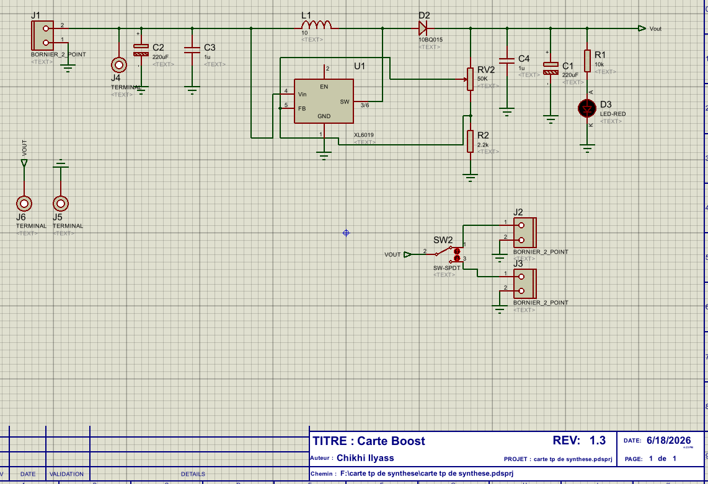
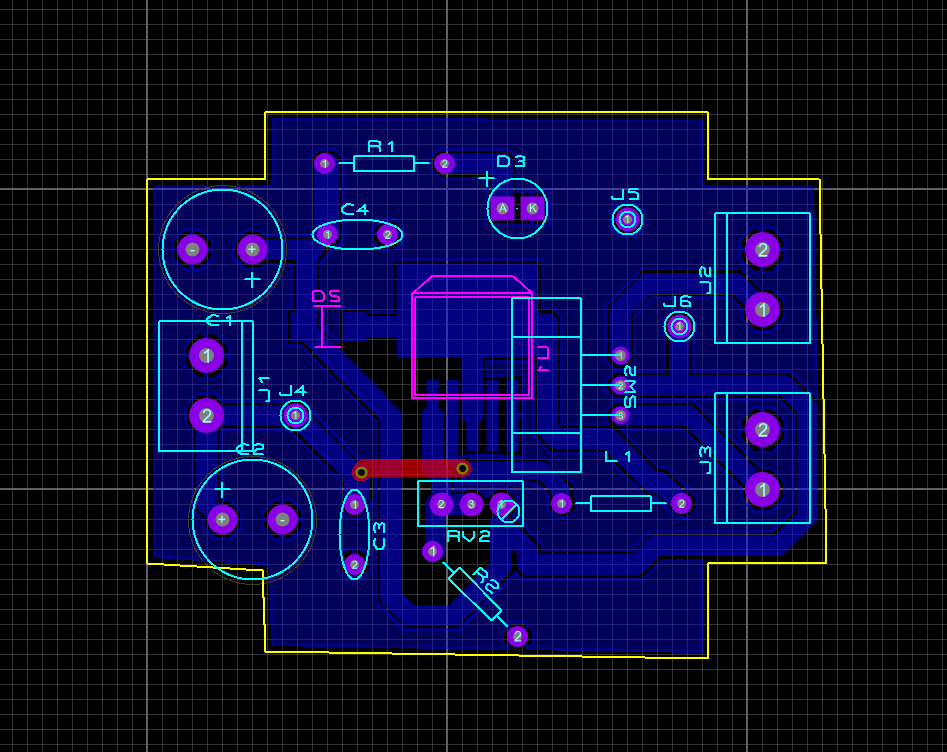
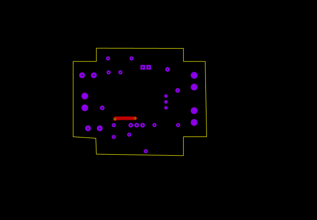
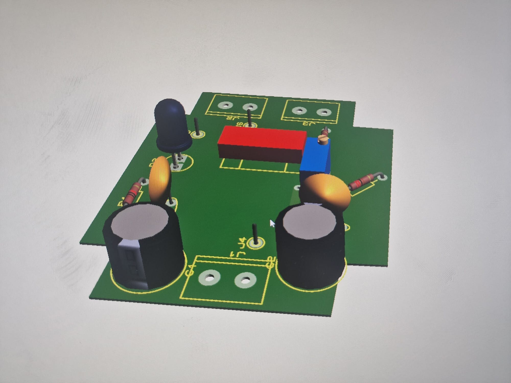
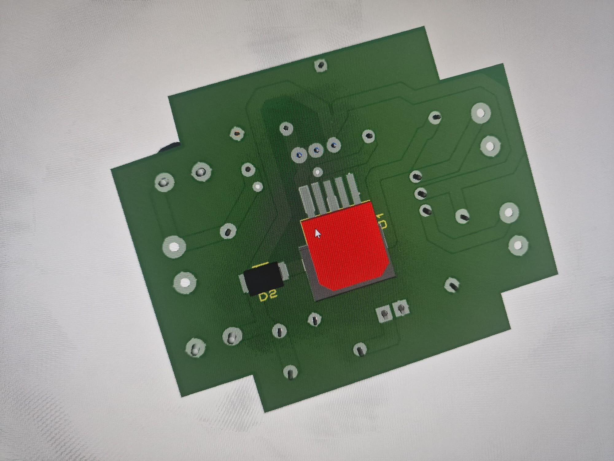

# XL6019 Adjustable Boost Converter

A custom PCB for a DC–DC boost converter based on the XL6019, designed for an adjustable output targeting approximately 30 V.

## Project overview

I designed and assembled this board as a personal power-electronics project. The circuit uses the XL6019 in a boost topology. A potentiometer sets the output through the feedback network, and a Smart Battery Monitor is used to display the output voltage.

The fabrication notes describe the design and assembly choices, including the power-stage layout, input/output filtering, test points and output display.

## Main features

- XL6019-based boost-converter topology
- Adjustable output, with a design target of approximately 30 V maximum
- Potentiometer-based output adjustment
- Smart Battery Monitor for voltage display
- PCB layout intended to keep the power path and test connections accessible

The achievable output voltage and current depend on the input source, load, component selection and thermal conditions. The project material does not specify a verified output-current rating.

## Design images

### Schematic

### PCB layout

### Bottom copper layer

### 3D PCB previews

These are CAD previews, not photographs of the assembled board.

## Build and validation

The fabrication dossier reports that the PCB was fabricated, populated, soldered and functionally checked. The uploaded dossier lists test procedures and expected outcomes but does not include numerical measurement results or a photograph of the assembled prototype.

The dossier also describes some component values as used or planned; check the final as-built bill of materials before reproducing the board.

## Repository contents

- Schematic screenshot
- PCB layout screenshots
- 3D CAD previews

The native CAD source project and a photograph of the assembled board are not included in this initial upload.
